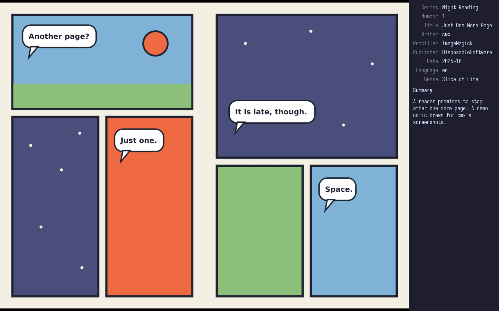

<p align="center"></p>

<h1 align="center">cmx</h1>

<p align="center">A minimal comic reader for <code>.cbz</code> files on Wayland. <i>cmx is pronounced "see-mix".</i></p>

> [!WARNING]
> **Certified, artisanal, vibe-coded slop.**
>
> No human has read this code. An AI wrote all of it while a person said "yeah, looks
> good" and pressed Enter a lot.

A GTK 4 port of the macOS app [cmx](https://github.com/DisposableSoftware/cmx). It shows
one page at a time, or two side by side, fit to the window, with nothing drawn over the
image. It has no library: it opens whatever file you give it and remembers where you
stopped reading.

<p align="center"></p>

## Features

- Open comics from the command line, a file manager, `Ctrl+O`, or by dropping them on a
  window. Each comic gets its own window; opening one that is already open brings its
  window forward.
- Reopening a comic resumes at the last page you read. With no files, cmx reopens the
  comic you read last.
- Reads `ComicInfo.xml` when present: series, number and title go in the window title,
  and every field is in the info panel (`Ctrl+I`).
- Dual-page layout (`d`). Landscape pages are never paired.
- JPEG, PNG, GIF, WebP, AVIF, BMP and TIFF pages.
- File manager thumbnails show the cover (`cmx --thumbnail`).

CBR (RAR) archives are not supported. A RAR renamed to `.cbz` is detected, and cmx tells
you to convert it.

## Keys

| Key | Action |
|---|---|
| `Space` `→` `↓` `Page Down` `l` `j` | Next page |
| `Shift+Space` `←` `↑` `Page Up` `h` `k` | Previous page |
| `Home` / `End` | First / last page |
| `d` | Toggle dual-page layout |
| `f` `F11` / `Esc` | Toggle / leave fullscreen |
| `Ctrl+I` | Comic info |
| `Ctrl+O` | Open comics |
| `Ctrl+N` / `Ctrl+W` | New / close window |
| `F1` | About |
| `q` `Ctrl+Q` | Quit |

Every binding can be changed in `~/.config/cmx/keybindings.ini`; see `man cmx`.

## Install

```sh
nix run github:DisposableSoftware/cmx-gtk -- comic.cbz
```

Or as a flake input:

```nix
{
  inputs.cmx.url = "github:DisposableSoftware/cmx-gtk";

  # NixOS
  imports = [ inputs.cmx.nixosModules.default ];
  programs.cmx.enable = true;

  # or home-manager, which can also write the settings
  imports = [ inputs.cmx.homeManagerModules.default ];
  programs.cmx = {
    enable = true;
    keybindings.quit = [ "<Ctrl>q" ];
  };
}
```

The package installs a desktop entry for `.cbz` files and a thumbnailer, so file managers
that follow the freedesktop thumbnail spec (Nautilus, Thunar, Nemo and others) show
covers.

### Without Nix

You need Rust 1.92 or later and GTK 4.20 or later with its development files. WebP and
AVIF pages also need the gdk-pixbuf loaders for those formats (`webp-pixbuf-loader`,
and `libavif` built with its gdk-pixbuf loader).

```sh
cargo build --release
install -Dm755 target/release/cmx ~/.local/bin/cmx
```

## Usage

```sh
cmx comic.cbz other.cbz   # a window for each
cmx                       # reopen the comic read last
cmx --help
man cmx                   # every binding and setting
```

Settings live in `~/.config/cmx/config.ini` and keybindings in
`~/.config/cmx/keybindings.ini`. Both are created on first start with every default
commented out; remove the `# ` from a line to change it. Reading progress is kept in
`~/.local/state/cmx/state.ini`.

## Development

What the app does is written down in [`spec/`](spec/README.md); see
[`CLAUDE.md`](CLAUDE.md) for how changes are made.

```sh
nix develop                 # cargo, clippy, rustfmt, rust-analyzer, GTK 4
cargo run -- tests/fixtures/six.cbz
cargo clippy --all-targets -- -D warnings
cargo test
nix build                   # ./result/bin/cmx
scripts/manual/headless.sh scripts/manual/paging.sh
```

The test comics are in `tests/fixtures/`. `scripts/make-demo.sh` draws the demo comic,
and `scripts/manual/screenshot.sh` takes the screenshot above from it.

## License

MIT, see [LICENSE](LICENSE).
